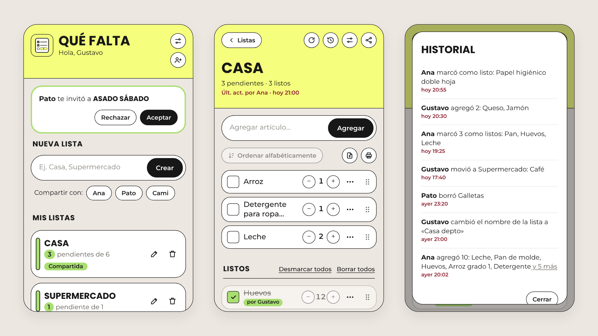

# Qué Falta

Listas compartidas en tiempo real para la casa: compras, pendientes y lo que haga falta.
Cuando alguien agrega algo o lo marca como listo, se actualiza al instante en el teléfono de todos.



## Funciones

- **Listas compartidas en tiempo real.** Los cambios llegan al instante a todas las personas de la lista.
- **Compartir fácil.** Por enlace (WhatsApp, correo…) o invitando directo a tus contactos, que reciben una invitación para aceptar o rechazar.
- **Pendientes arriba, listos abajo.** Orden alfabético automático, o arrastrando para ordenar a mano.
- **Cantidades** por artículo, edición, borrado y **mover artículos** a otra lista.
- **Quién lo marcó** como listo (opcional por lista) y **última actualización**.
- **Historial** de las últimas acciones, agrupadas de forma inteligente: si alguien agrega 10 artículos seguidos se ve como una sola acción, y los toques por error no aparecen.
- **Exportar** lo pendiente como texto o PDF, e **imprimir** una versión limpia.
- **Permisos:** solo quien creó la lista puede renombrarla o borrarla; los demás pueden salir de ella.
- **Instalable en el teléfono** como app (PWA), sin pasar por una tienda.
- **Entrada sin contraseña:** se ingresa con un enlace que llega al correo.

## Tecnologías

| Parte | Herramienta |
|---|---|
| Interfaz | React 19 + Vite |
| Base de datos, usuarios y tiempo real | Supabase (PostgreSQL, Auth, Realtime) |
| Arrastrar para ordenar | dnd-kit |
| PDF | jsPDF (se carga solo al exportar) |
| Publicación | Vercel |

### Algunas decisiones técnicas

- **Seguridad en la base de datos (RLS).** Cada tabla tiene reglas que garantizan que solo los miembros de una lista pueden ver o modificar sus datos, aunque alguien intente saltarse la app.
- **Lógica en el servidor.** Compartir, aceptar invitaciones, crear contactos y salir de una lista son funciones de PostgreSQL, para que sean atómicas y seguras. El historial y la "última actualización" se registran con *triggers*.
- **Historial agrupado en el cliente.** Se guarda una fila por acción y la app las agrupa al mostrarlas ([`src/history.js`](src/history.js)), así la regla de agrupación se puede ajustar sin tocar los datos. Tiene pruebas automáticas.
- **Sin servidor propio.** Todo funciona con los planes gratuitos de Supabase y Vercel.

## Cómo ejecutarlo

**Requisitos:** Node.js 20.19 o superior y una cuenta gratuita de [Supabase](https://supabase.com).

1. **Instalar dependencias**
   ```bash
   npm install
   ```
2. **Crear la base de datos.** En Supabase, crea un proyecto y abre *SQL Editor → New query*. Pega el contenido de [`supabase/schema.sql`](supabase/schema.sql) y dale *Run*.
3. **Configurar el inicio de sesión.** En *Authentication → URL Configuration*, agrega `http://localhost:5173` a *Redirect URLs*.
4. **Variables de entorno.** Copia `.env.example` como `.env.local` y completa la URL del proyecto y la *publishable key* (en *Project Settings → API*).
5. **Iniciar**
   ```bash
   npm run dev
   ```
   y abre http://localhost:5173.

### Publicar en Vercel

1. Importa el repositorio en [Vercel](https://vercel.com).
2. En *Environment Variables* agrega `VITE_SUPABASE_URL` y `VITE_SUPABASE_ANON_KEY`.
3. Después del primer deploy, en Supabase (*Authentication → URL Configuration*) pon la dirección de Vercel en *Site URL* y en *Redirect URLs*.

> El correo gratuito de Supabase permite pocos envíos por hora. Para uso real conviene configurar un SMTP propio (por ejemplo, Gmail o Brevo) en *Authentication → Emails → SMTP Settings*.

## Pruebas

```bash
npm test     # pruebas del agrupamiento del historial
npm run lint # revisión del código
```

## Estructura

```
supabase/schema.sql   Base de datos completa: tablas, seguridad, funciones y tiempo real
src/
  App.jsx             Sesión, nombre del usuario y navegación
  Home.jsx            Mis listas, crear lista, invitaciones, ajustes
  ListView.jsx        Una lista: artículos, orden, listos, barra de acciones
  ItemSheet.jsx       Opciones de un artículo (editar, mover, borrar)
  ShareSheet.jsx      Compartir por enlace o con contactos
  ListSettings.jsx    Ajustes de la lista (nombre, quién marcó, salir/borrar)
  HistorySheet.jsx    Ventana del historial
  history.js          Agrupamiento del historial (+ history.test.js)
  ExportSheet.jsx     Exportar como texto o PDF
  exporter.js         Arma el texto y el PDF
  PrintView.jsx       Versión para imprimir
  config.js           Nombre de la app y mensaje para compartirla
  router.js           Navegación mínima por URL
  live.js             Recarga al volver a la app o recuperar conexión
public/               Íconos y manifest (instalación como app)
```
